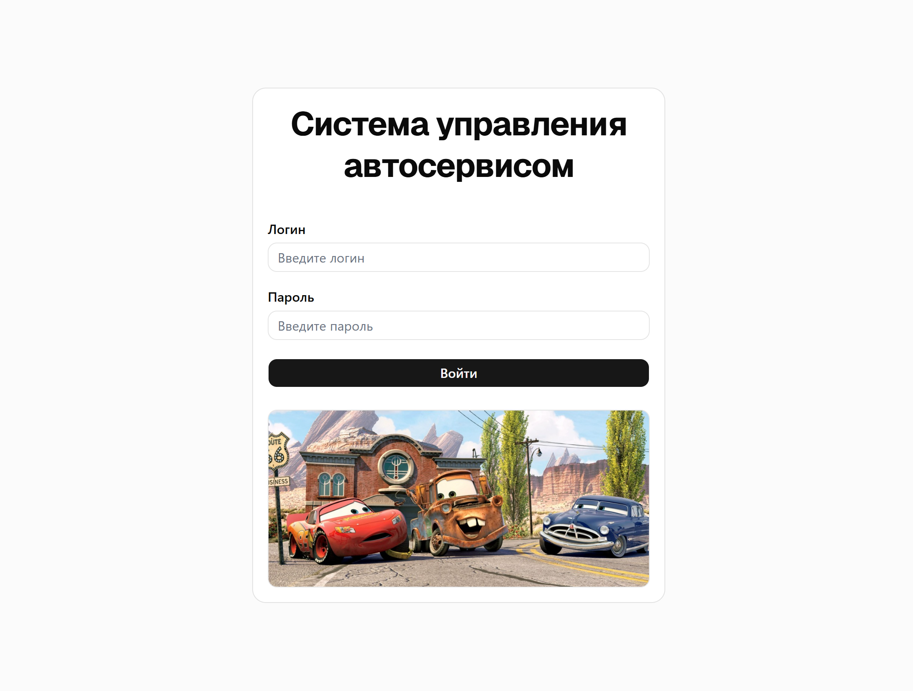
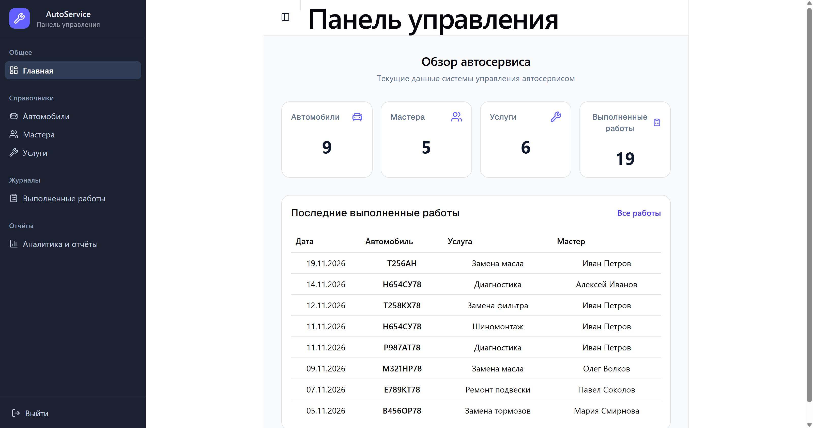
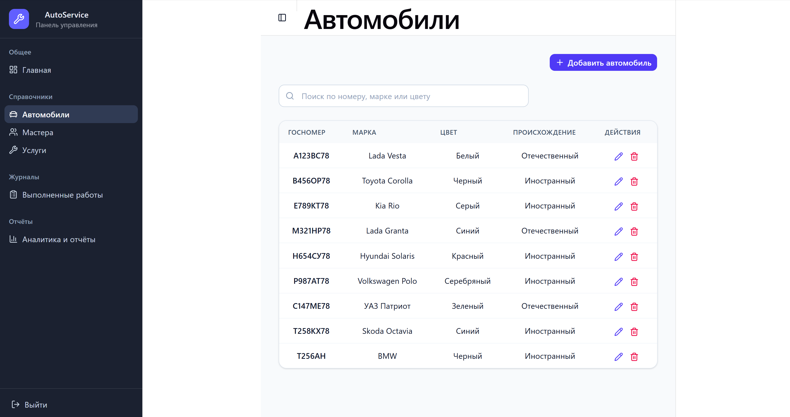
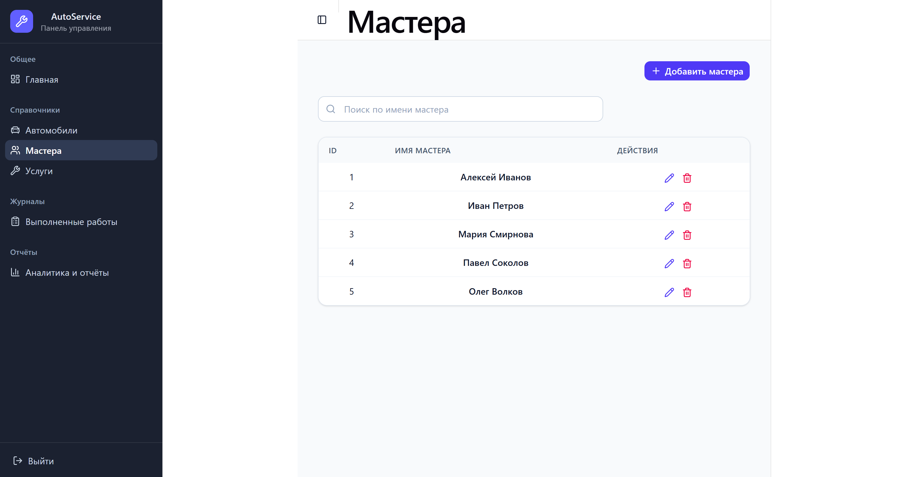
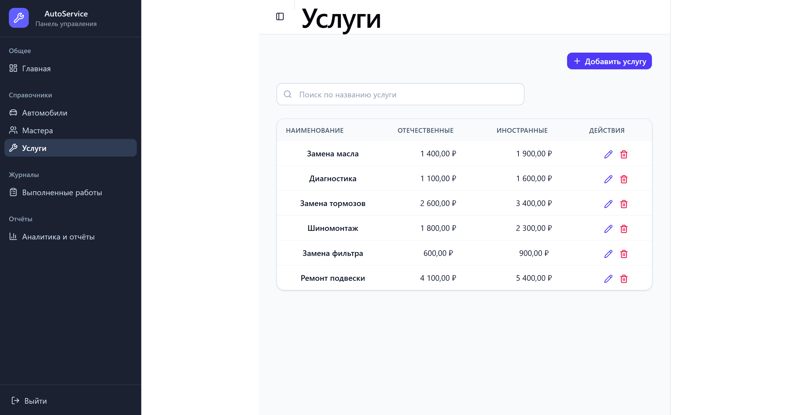
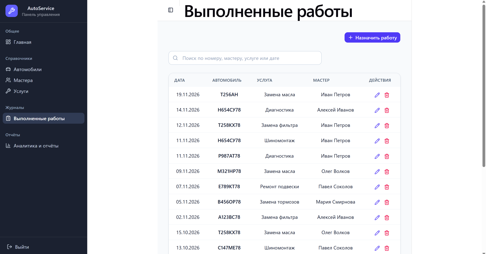
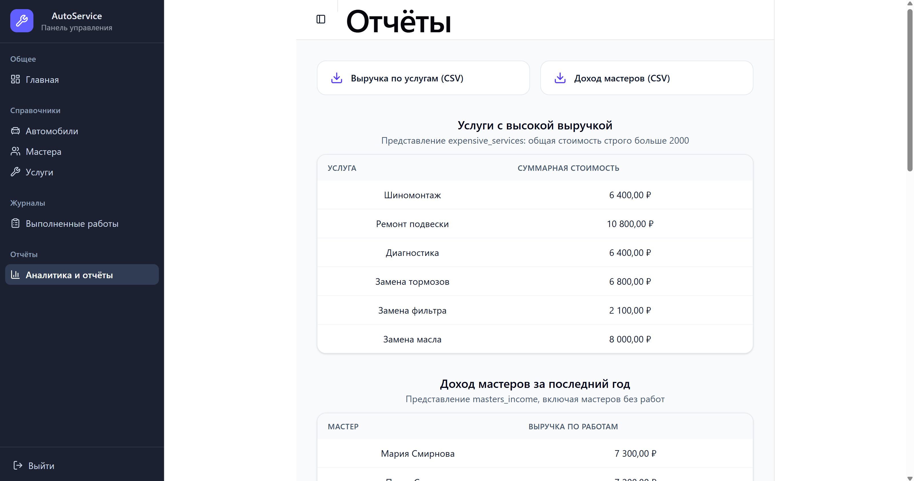
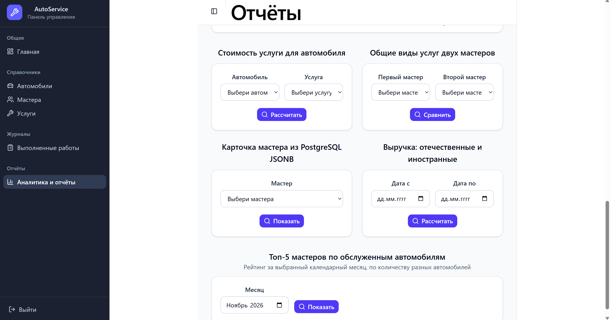

<div align="center">

# AutoService

**Веб-приложение для управления автосервисом**  
Учёт автомобилей, мастеров, услуг и выполненных работ с аналитикой и отчётами.


</div>

## Возможности

- **Справочники:** автомобили, мастера и услуги — поиск и CRUD.
- **Журнал работ:** история обслуживания с привязкой к мастеру, автомобилю и услуге.
- **Панель управления:** сводная статистика и последние работы.
- **Отчёты:** выручка, средняя стоимость обслуживания, загрузка мастеров и экспорт в CSV.
- **Авторизация:** Spring Security, сессии и роли `ADMIN` / `USER`.

## Интерфейс

### Авторизация

Вход в систему по логину и паролю. Доступ к данным и операциям зависит от роли пользователя: `ADMIN` или `USER`.

<p align="center">
  
</p>

### Панель управления

Главная страница показывает количество автомобилей, мастеров, услуг и выполненных работ, а также список последних обслуживаний.

<p align="center">
  
</p>

### Автомобили

Справочник хранит **государственный номер, марку, цвет и происхождение** автомобиля (отечественный или иностранный). Можно искать автомобили по номеру, марке и цвету; администратор может добавлять, редактировать и удалять записи.

<p align="center">
  
</p>

### Мастера

Справочник сотрудников с поиском по имени. Администратор управляет записями мастеров; на уровне базы данных действует ограничение **не более 10 мастеров**.

<p align="center">
  
</p>

### Услуги

Каталог видов обслуживания с **отдельными ценами для отечественных и иностранных автомобилей**. Доступны поиск по названию и, для администратора, создание, изменение и удаление услуг.

<p align="center">
  
</p>

### Выполненные работы

Журнал связывает **дату выполнения, автомобиль, мастера и услугу**. Можно искать записи и просматривать историю обслуживания; администратор назначает новые работы, редактирует и удаляет существующие. Ограничения на выполнение работ проверяет PostgreSQL.

<p align="center">
  
</p>

### Отчёты и аналитика

Раздел содержит расчёты **выручки по услугам, дохода мастеров, средней стоимости обслуживания**, сравнение услуг двух мастеров, сведения об отдельном мастере, выручку по типам автомобилей и рейтинг мастеров за месяц. Для доступных сводок предусмотрен **экспорт в CSV**.

<p align="center">
  
</p>

<p align="center">
  
</p>

## Архитектура

```text
React + TypeScript (frontend/)
            │ HTTP /api
            ▼
Spring Boot + Spring Security + JDBC (backend/)
            │ SQL / PL/pgSQL
            ▼
        PostgreSQL
```

Миграции схемы, представления, функции, процедуры и триггеры находятся в [`backend/src/main/resources/db/migration/`](backend/src/main/resources/db/migration/). Управление версиями БД выполняет **Flyway**.

## Локальный запуск

Нужны **JDK 21**, **PostgreSQL**, **Node.js** и **npm**. Для локального профиля настрой подключение к БД `autoservice_dev` (в проекте использовался порт `5433`) и секреты backend — не добавляй их в Git.

```powershell
# Клонирование
git clone https://github.com/filon6/auto-service-management-system.git
cd auto-service-management-system
```

**Терминал 1 — backend:**

```powershell
cd backend
.\mvnw.cmd spring-boot:run "-Dspring-boot.run.profiles=local"
```

**Терминал 2 — frontend (из корня репозитория):**

```powershell
cd frontend
npm.cmd install
npm.cmd run dev
```

Приложение: **http://localhost:5173** · API: **http://localhost:8081**. В режиме разработки Vite проксирует `/api` на backend.

## REST API

| Раздел | Маршруты |
| --- | --- |
| Авторизация | `/api/auth/login`, `/api/auth/logout`, `/api/auth/me`, `/api/auth/csrf` |
| Справочники | `/api/cars`, `/api/masters`, `/api/services` |
| Выполненные работы | `/api/works` |
| Отчёты | `/api/reports/*` |

Для справочников и работ предусмотрены `GET`, `POST`, `PUT`, `DELETE`. Изменение данных доступно роли `ADMIN`; `USER` имеет доступ к просмотру. Подробные операции и аналитические запросы реализованы в backend.